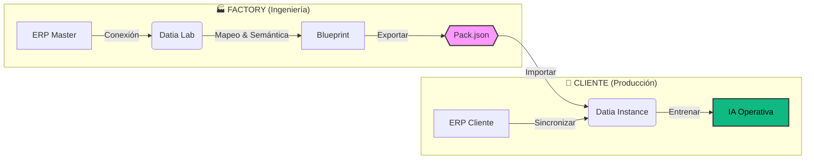
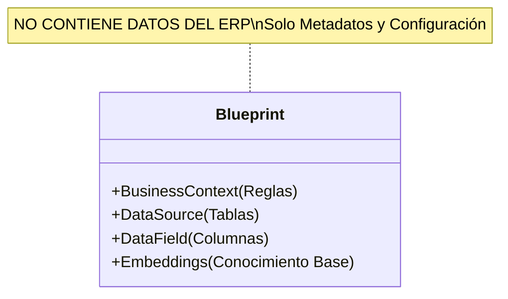
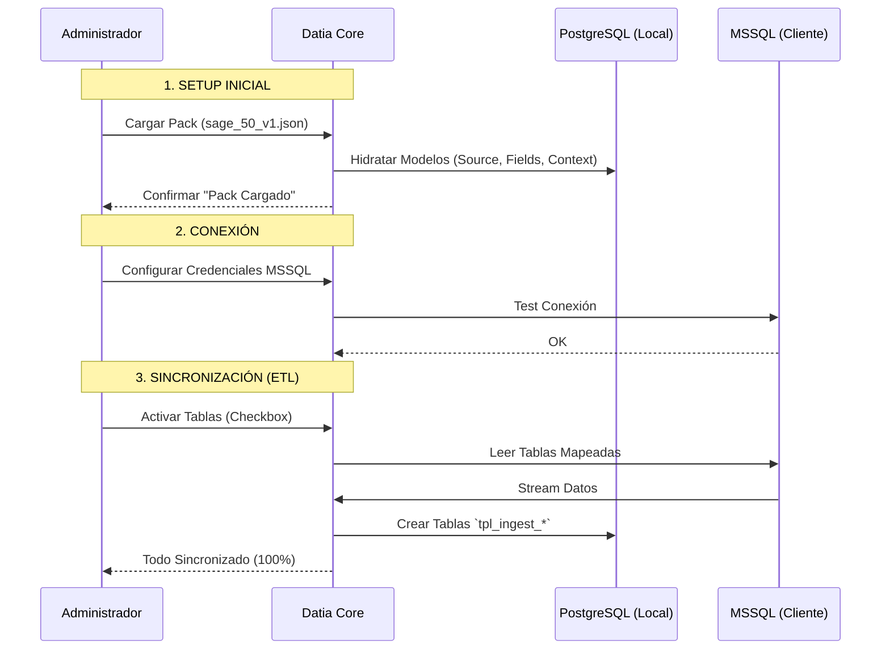

# 13 - Ciclo de Vida de Plantillas (Template Lifecycle)

> [!NOTE]
> Este patrón detalla paso a paso cómo **Datia** transforma el conocimiento de negocio en activos reutilizables ("Packs") y cómo estos se despliegan en clientes finales. Es la guía definitiva para la arquitectura multi-inquilino (SaaS).

## 📊 Visión Global del Proceso

El ciclo de vida se divide en dos grandes mundos: el **Entorno de Ingeniería** (donde se crea la inteligencia) y el **Entorno de Cliente** (donde se consume).

---

## 🛠️ Fase 1: Creación del Blueprint (Factory)

En esta etapa, los ingenieros de Datia definen "qué es importante" en un ERP específico (ej. SAGE, Navision).

### Pasos Operativos:
1.  **Conexión Master:** Se conecta una instancia de Datia a un ERP de prueba con datos genéricos pero estructura real.
2.  **Selección de Tablas:** Se eligen las tablas críticas (ej. `CabeceraPedido`, `LineasPedido`) y se ignoran las tablas de sistema/basura.
3.  **Mapeo Semántico:** Se asignan nombres de negocio a las columnas técnicas.
    *   `C_2023_X` -> "Total Neto"
    *   `CLI_ID` -> "Código Cliente"
4.  **Enriquecimiento AI:** Se añaden descripciones funcionales ("Esta tabla contiene los pedidos firmados pero no servidos").

---

## 📦 Fase 2: Empaquetado y Distribución

Una vez validado el modelo en el laboratorio, se exporta.

*   **Comando:** `python manage.py export_template --pack=sage_50_v1`
*   **Artifact:** Un archivo JSON (`sage_50_v1.json`) que contiene toda la inteligencia pero **cero datos sensibles**.
*   **Versionado:** `v1.0` (Inicial), `v1.1` (Mejoras en descripciones), etc.

---

## 🚀 Fase 3: Despliegue en Cliente (Hydration)

El cliente recibe una instancia de Datia "vacia" y el Pack correspondiente.

### Diagrama de Secuencia de Despliegue

---

## 🧠 Fase 4: Activación de la Inteligencia

Con los datos sincronizados y la semántica cargada, el sistema cobra vida.

### A. Auto-Entreno (Fine-Tuning RAG)
El sistema genera vectores específicos combinando el **Conocimiento del Pack** con los **Datos Reales** del cliente.

1.  **Validación de Estructura:** ¿Las columnas del cliente coinciden con el Pack? (Si faltan, se ignoran agnósticamente).
2.  **Generación de SQL:** La IA practica consultas sobre los datos reales (`tpl_ingest_*`).
3.  **Indexación:** Se guardan los vectores en `tpl_ai_embeddings`.

### B. Consumo (Usuario Final)
El usuario pregunta "Ventas de ayer".
1.  La IA busca en `tpl_ai_embeddings`.
2.  Encuentra el SQL plantilla.
3.  Ejecuta sobre `tpl_ingest_ventas`.
4.  Devuelve el resultado.

---

## 🔄 Mantenimiento y Actualizaciones

¿Qué pasa si mejoramos el Pack?

1.  **Importar Nueva Versión:** Se carga `sage_50_v2.json`.
2.  **Update Inteligente:**
    *   Se actualizan descripciones y sinónimos.
    *   **NO** se tocan las credenciales ni los datos sincronizados.
    *   Se marcan los embeddings antiguos como "outdated".
3.  **Re-Entreno Ligero:** El sistema actualiza solo los vectores afectados.

> [!TIP]
> **Factory Reset:** Si algo sale mal, la función de reset (`TRUNCATE`) permite vaciar los datos (`tpl_ingest_*`) manteniendo la configuración (`tpl_data_*`), permitiendo re-sincronizar en segundos sin reconfigurar todo el mapeo.
